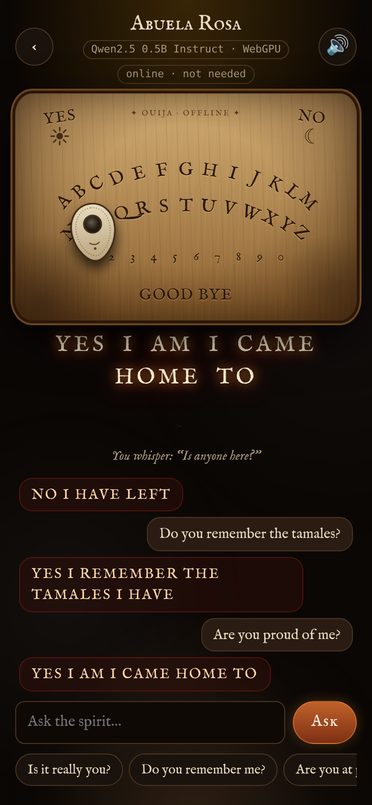
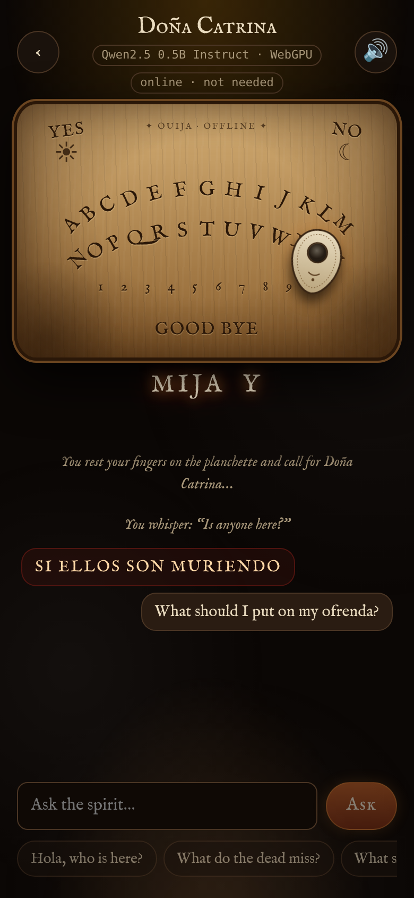
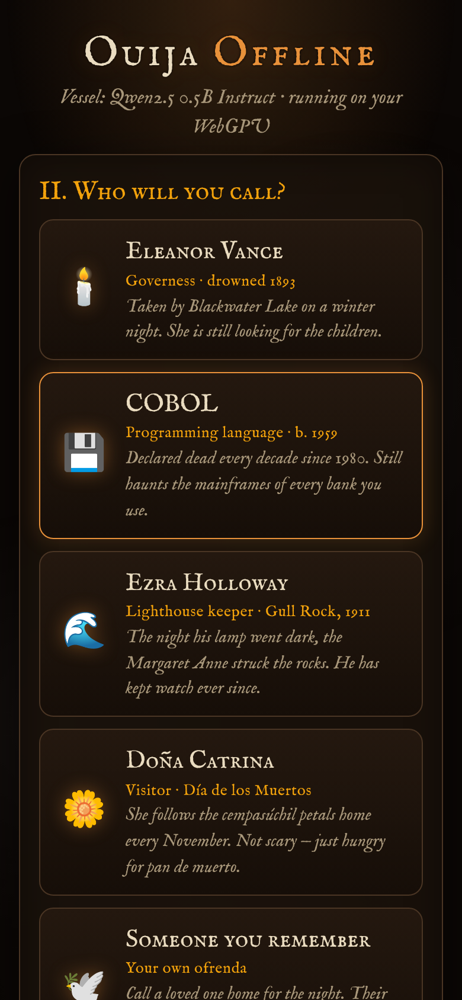

# 👻 Ouija Offline

**A séance in your pocket.** An open-weight language model runs *entirely on your phone* and speaks to you through a candlelit Ouija board, one letter at a time.
No server, no account, no API key. After the first visit it works in **airplane mode**.

Built for the [Hacktoberfest Open-Source AI Challenge, Week 4: Ghost in the Machine](https://dev.to/challenges/hacktoberfest-week4-2026-10-26).

<p align="center">
  
  
  
</p>

## What it does

1. **Choose a vessel**: an open-weight model (GGUF) that downloads once and stays on the device.
2. **Choose a spirit** and ask it questions. The planchette glides across the board, spelling the answer while the model is still generating it. Letters glow, the phone buzzes on each one, and an ambient drone hums underneath.

| Spirit | Who they are |
| --- | --- |
| 🕯️ **Eleanor Vance** | Governess who drowned in Blackwater Lake in 1893. Still looking for the children. |
| 💾 **COBOL** | The programming language that has been declared dead every decade since 1980, and still runs your bank. |
| 🌊 **Ezra Holloway** | Lighthouse keeper whose lamp went dark one stormy night in 1911. |
| 🌼 **Doña Catrina** | Día de los Muertos visitor who follows the cempasúchil petals home. Not scary, just hungry for pan de muerto. |
| 🕊️ **Someone you remember** | Your own ofrenda. Enter a loved one's name and a few memories, and call them home for the night. The memories never leave the phone. |

### Haunted details

- **Always say goodbye.** Leave the board without saying goodbye and the next time you open the app, *Something* is waiting, and it won't let any other spirit through until you close the board properly.
- **Shake your phone** and the spirits notice (DeviceMotion).
- **Stay silent** for 45 seconds and the planchette starts moving on its own.
- The status chip turns green when you go offline: *"offline · the veil is thin"*.
- **Bring your own spirit:** load any `.gguf` file from your phone's storage and it speaks through the board.

## How it works

```
your phone
│
├─ index.html + js/ ──► wllama (llama.cpp compiled to WebAssembly, in a Worker)
│                         ├─ WebGPU when the browser has it
│                         └─ multi-threaded CPU otherwise
│
├─ board.js     token stream → finished words → planchette moves
│               (the board starts moving before the model has finished)
├─ sw.js        app shell + 9 MB runtime cached for offline use,
│               plus COOP/COEP headers so llama.cpp can use every core
├─ OPFS         model weights, cached by wllama after the first download
└─ localStorage your remembered loved one, the "unclosed board" flag

        ▲ one-time download of the open weights from Hugging Face, then never again
```

- **Inference:** [wllama](https://github.com/ngxson/wllama) v3, the WebAssembly binding for [llama.cpp](https://github.com/ggml-org/llama.cpp), vendored in `vendor/wllama/`. It uses WebGPU when available, falls back to CPU, and retries on CPU if a phone's GPU driver chokes.
- **Models** (all Q4_K_M GGUF, via [bartowski](https://huggingface.co/bartowski)'s quantizations):

  | Vessel | Model | Size | License |
  | --- | --- | --- | --- |
  | The Medium (default) | Qwen2.5 0.5B Instruct | 398 MB | Apache-2.0 |
  | The Wisp | SmolLM2 360M Instruct | 271 MB | Apache-2.0 |
  | The Oracle | Llama 3.2 1B Instruct | 808 MB | Llama 3.2 Community |

- **Prompting for tiny models:** each spirit is a system prompt plus three example exchanges given as real chat turns. Sub-1B models copy the *shape* of examples much more reliably than they follow rules, so the examples are what keep answers short, uppercase, and in character. Output is then cleaned into board-legal words (A–Z, 0–9, YES, NO, GOOD BYE).
- **Streaming to the board:** the model streams tokens; finished words go into a queue; the planchette consumes the queue. You watch the spirit "think" in real time instead of waiting for a full reply.
- **No build step, no dependencies:** plain ES modules, synthesized WebAudio (no sound files), and open fonts (IM Fell English, SIL OFL) vendored for offline use.

## Run it

It's a static site. Any static host works; it needs HTTPS (or localhost) for service workers and WebGPU.

```bash
node scripts/serve.mjs 8080
```

Then open <http://localhost:8080>. To try it on a phone, deploy it (below) or reach your laptop over HTTPS, then use **Add to Home Screen**.

### Deploy to GitHub Pages

The included workflow (`.github/workflows/pages.yml`) publishes the site on every push to `main`. Enable it once in **Settings → Pages → Source: GitHub Actions**.

### Browser support

- **Android, Chrome:** WebGPU and multi-threaded CPU. Best experience.
- **iOS 26+, Safari:** WebGPU. Older iOS runs on the CPU.
- **Desktop Chrome, Edge, Safari, Firefox:** all work, and the GPU is used where WebGPU is available.

A phone with 3–4 GB of RAM handles The Medium comfortably. On older phones, pick The Wisp.

## Privacy

Nothing you type is sent anywhere. There is no backend. The only network traffic is the one-time download of the app and the model weights. After that you can switch on airplane mode and keep talking to the dead.

## Credits & licenses

- App code: MIT (see `LICENSE`)
- wllama: MIT (`vendor/wllama/LICENSE`); llama.cpp: MIT
- IM Fell English fonts: SIL Open Font License (`fonts/OFL.txt`)
- Model weights are downloaded from Hugging Face under their own licenses (listed above).
