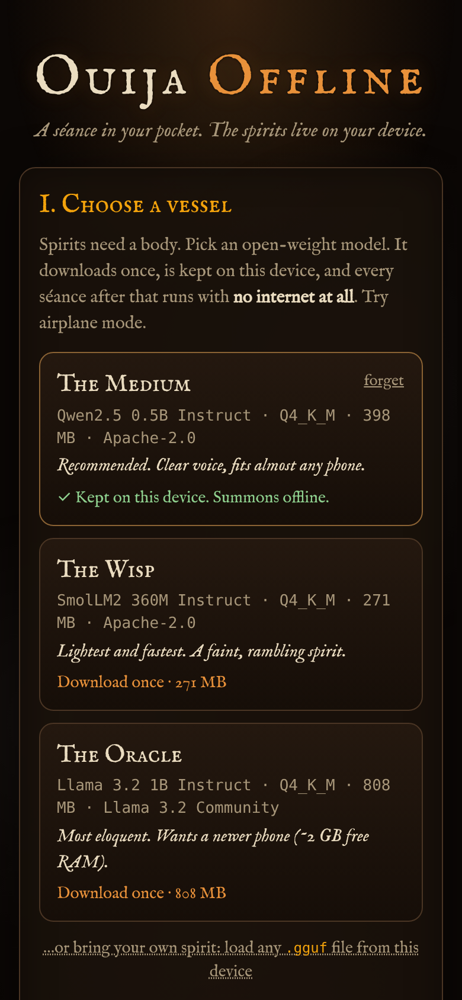
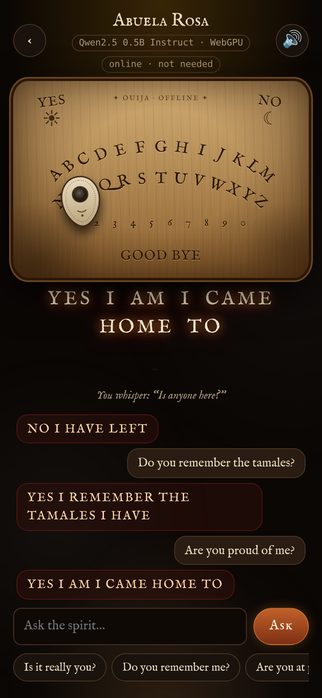
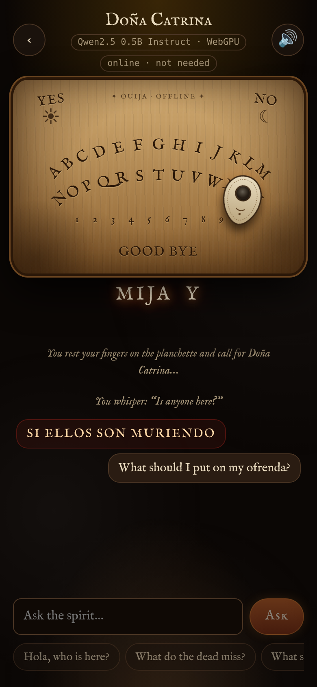
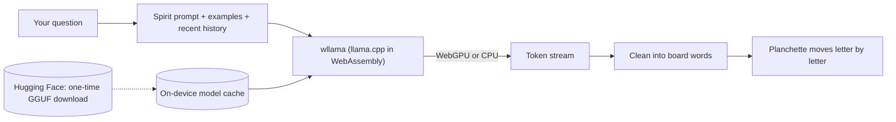

*This is a submission for the [Hacktoberfest Open-Source AI Challenge Week 4: Ghost in the Machine](https://dev.to/challenges/hacktoberfest-week4-2026-10-26)*

## What I Built

**Ouija Offline** is a Ouija board you carry in your pocket. You ask a question, and a planchette slides across a candlelit wooden board, spelling out an answer one glowing letter at a time. The phone buzzes as it lands on each letter, and a low drone hums underneath.

The "spirit" is an open-weight language model running **entirely on your phone**, inside the browser. There's no server, no account, and no API key. Once the model has downloaded, you can put the phone in airplane mode, turn off the lights, and the board still answers. That's how I read the theme: the ghost is literally *in the machine*.

You can call:

- 🕯️ **Eleanor Vance**, a governess who drowned in Blackwater Lake in 1893 and is still looking for the children
- 💾 **COBOL**, a programming language declared dead every decade since 1980 that still runs your bank (it has opinions about JavaScript)
- 🌊 **Ezra Holloway**, the lighthouse keeper whose lamp went dark the night the *Margaret Anne* hit the rocks
- 🌼 **Doña Catrina**, a Día de los Muertos visitor who follows the marigold petals home and mostly wants pan de muerto
- 🕊️ **Someone you remember**: type in a loved one's name and a few memories, and call them home for the night. It's a small digital ofrenda.

Every Ouija board comes with one rule:

> **Always say goodbye.**

If you leave the board without saying goodbye, the next time you open the app *Something* is waiting at the top of the list. It won't let any other spirit through until you sit down with it and close the board properly. Shake your phone and the spirits notice. Stay silent too long and the planchette starts moving by itself.

## Demo

🔗 **Try it:** https://samarthsubramanya.github.io/Hacktoberfest26_W4/

For the full effect, open it on your phone, tap **Add to Home Screen**, download a vessel, switch on **airplane mode**, and ask, *"Is anyone here?"*

<!-- Add a short screen recording here: the airplane-mode toggle, then the planchette spelling an answer. -->

| Choose a vessel | Someone you remember | Doña Catrina |
| --- | --- | --- |
|  |  |  |

## Code



## How I Built It

**The engine is [wllama](https://github.com/ngxson/wllama) v3**, the WebAssembly build of **[llama.cpp](https://github.com/ggml-org/llama.cpp)**. That one open-source runtime does all the heavy lifting:

- It runs on **WebGPU** when the phone's browser supports it and falls back to **multi-threaded CPU** when it doesn't, so almost any phone can hold a séance. If a phone advertises WebGPU but its driver fails, the app quietly retries on the CPU.
- It loads standard **GGUF** files, so swapping models just means changing a URL. I ship three "vessels", all open-weight and quantized to Q4_K_M:
  - **The Medium**: Qwen2.5 0.5B Instruct, 398 MB, Apache-2.0 (the default)
  - **The Wisp**: SmolLM2 360M Instruct, 271 MB, Apache-2.0, for older phones
  - **The Oracle**: Llama 3.2 1B Instruct, 808 MB, the most eloquent ghost
  - **…or bring your own:** pick any `.gguf` file on your phone and it speaks through the board.
- It caches the weights in the browser's **Origin Private File System**, so each phone downloads them once.

The rest is deliberately plain open web tech, with **no build step and no dependencies**: ES modules, CSS for the board, synthesized WebAudio for the drone and the wooden "tock" of the planchette, and the open IM Fell English fonts bundled in the repo. A service worker keeps the app and the 9 MB llama.cpp runtime on the device. It also adds the cross-origin isolation headers that GitHub Pages can't set, which lets llama.cpp use every CPU core.

### Three things I learned getting a 0.5B model to haunt a board

**1. Tiny models follow examples more than rules.** A list of rules ("answer in at most 6 words, uppercase, stay in character") only gets you part of the way with a 0.5B model. With the examples pasted into the system prompt, it still drifted into long, lowercase sentences. What worked best was giving each spirit **three example exchanges as real chat turns** (`user: Where are you?` → `assistant: UNDER THE ICE`). Small models copy the *shape* of a conversation remarkably well.

**2. One bad answer ruins the séance.** My first build opened every séance with a stage direction: *"(The living person has opened the board. Announce yourself.)"* The model answered with gibberish, the gibberish went into the chat history, and every later answer got worse. Opening with a plain *"Is anyone here?"* fixed the whole session. With small models, the history is part of the prompt.

**3. Streaming turns latency into suspense.** Tokens stream into a word queue, and the planchette starts moving as soon as the first word is complete, while the model is still generating the rest. Output is cleaned on the fly into what a board can spell (A–Z, 0–9, YES, NO, GOOD BYE). Tiny models also love to say GOODBYE in their very first answer, so a spirit isn't allowed to leave until it has answered a few questions.

## Why Does Open Innovation Matter?

**It works with the lights *and* the internet off.** This is a séance app, and the best place to use it is a dark room with no signal. With a closed API, the most atmospheric moment (airplane mode on, planchette still moving) would be an error message. With open weights running locally, the spirits don't need a network.

**Your dead stay yours.** The *Someone you remember* spirit asks for the name of a person you lost and the things they loved. That's about as personal as data gets. Here, those memories stay in the phone's local storage and are only ever read by a model running on the same phone. There's no server they could leak from, because there's no server.

**It costs nothing to run, so it can't be switched off.** There are no per-token charges, no rate limits, and no key to rotate. Every token is computed on the user's own device. The app is static files on GitHub Pages and the weights are openly licensed. If I stop maintaining it tomorrow, it keeps working on every phone that has already opened it, which suits a holiday about things that outlive us.

**I control how the ghost behaves.** Because I own the runtime and choose the weights, I can pick a model per device, tune sampling for eerie answers, cap tokens to fit a board, and let users **bring their own GGUF**: a fine-tune, another language, or a horror-tuned model. A closed endpoint allows none of that.

**Where open beat closed:** a frontier API would give smarter answers, but a Ouija spirit is *supposed* to be terse, cryptic, and a little wrong. A 400 MB open model that runs offline, privately, and for free on a phone suits the job better than a far bigger model that needs a connection and a credit card.

## My Agent Session

I designed and built this with an AI coding agent. It weighed mobile approaches, smoke-tested three models in a headless browser, found the history problem above, and verified the offline mode end to end.

<!-- Save the session with DevRelay and embed it here with the agent_session tag, or link to it. -->

## The Spirit of It

<!-- Swap in your own moment if you have one: try "Someone you remember" on your phone, in airplane mode, for someone you miss. -->

During testing I gave *Someone you remember* a grandmother's name and two lines of memories: *tamales every Christmas*, *called me mijo*. Then I asked, "Do you remember the tamales?" The planchette crawled across the board and spelled out **YES I REMEMBER THE TAMALES**.

It's a half-billion-parameter model doing next-token prediction. But it's running on the phone in your hand, with no one else listening, and for a second the line between past and present does feel a little thinner.

¡Feliz Día de los Muertos! And remember: **always say goodbye.** 🕯️

## Prize Categories

<!-- No partner technology is used yet, so this entry competes for the overall prize. If a Gemma vessel is added, list "Best Use of Gemma" here; otherwise delete this section before publishing. -->

Entering the overall prize.
